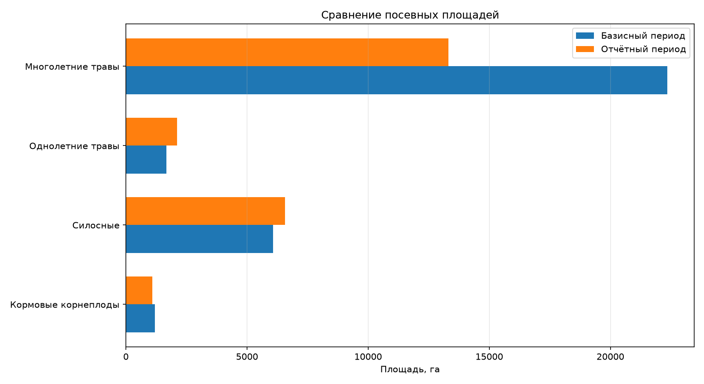
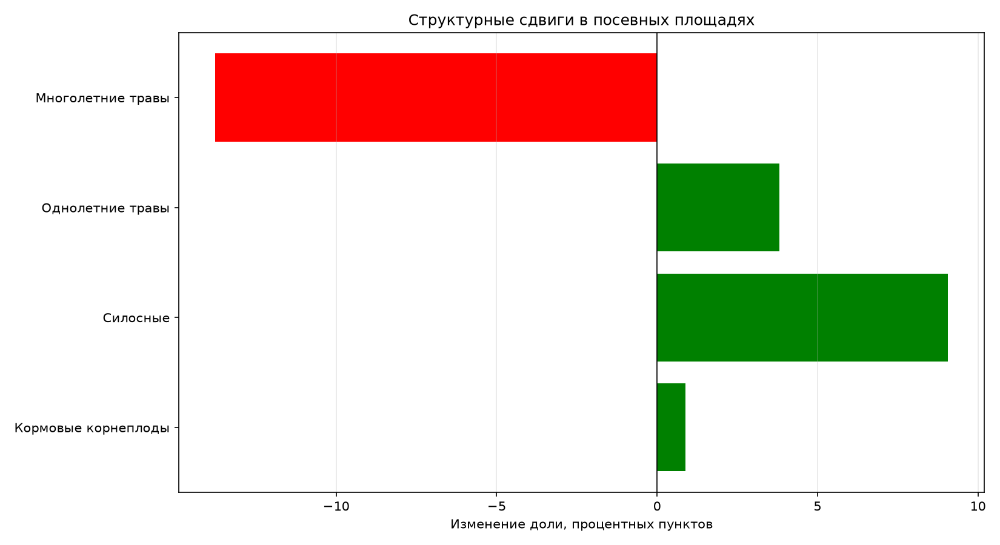

<div align="center">

# 📊 Оценка структурных сдвигов в посевных площадях

**Практическая работа № 2 · Статистика сельского хозяйства**

*Анализ изменения посевных площадей, структуры культур и средневзвешенной продуктивности.*

<br>


</div>

---

## 📑 Содержание

- [🎯 Цель работы](#-цель-работы)
- [📥 Исходные данные](#-исходные-данные)
- [🧮 Методика расчётов](#-методика-расчётов)
- [📈 Основные результаты](#-основные-результаты)
- [📊 Визуализация](#-визуализация)
- [📁 Структура проекта](#-структура-проекта)
- [⚙️ Установка и запуск](#️-установка-и-запуск)
- [📦 Результаты работы](#-результаты-работы)
- [📝 Вывод](#-вывод)

---

## 🎯 Цель работы

Исследовать изменения структуры посевных площадей между базисным и отчётным периодами, оценить интенсивность структурных сдвигов и определить влияние структуры посевов на средневзвешенные показатели продуктивности.

В рамках работы реализована программа на Python, которая автоматически выполняет расчёты, формирует таблицы Excel и строит графики.

## 📥 Исходные данные

Для анализа используются данные по четырём группам сельскохозяйственных культур.

| Группа культур | Площадь S₀, га | Площадь S₁, га | yₖ | yₚ |
|:---|---:|---:|---:|---:|
| Кормовые корнеплоды | 1 195 | 1 088 | 61,7 | 357 |
| Силосные | 6 076 | 6 574 | 62,4 | 394 |
| Однолетние травы | 1 676 | 2 116 | 25,1 | 497 |
| Многолетние травы | 22 351 | 13 311 | 32,7 | 377 |
| **Итого** | **31 298** | **23 089** | — | — |

**Обозначения:**
- **S₀** — площадь посевов в базисном периоде.
- **S₁** — площадь посевов в отчётном периоде.
- **yₖ** — заданный показатель кормовых единиц.
- **yₚ** — заданный показатель переваримого протеина.

## 🧮 Методика расчётов

Программа выполняет следующие вычисления:

| № | Показатель | Назначение |
|---:|:---|:---|
| 1 | Общая площадь | Определение суммарной площади посевов в каждом периоде |
| 2 | Удельный вес культур | Расчёт доли каждой группы в общей площади |
| 3 | Абсолютное изменение площади | Определение увеличения или сокращения площади в гектарах |
| 4 | Индекс площади | Сравнение площади отчётного периода с базисным |
| 5 | Структурный сдвиг | Определение изменения доли каждой группы в процентных пунктах |
| 6 | Сумма абсолютных сдвигов | Оценка совокупного изменения структуры |
| 7 | Линейный коэффициент | Оценка среднего абсолютного структурного изменения |
| 8 | Квадратический коэффициент | Оценка структурных сдвигов с учётом квадратов отклонений |
| 9 | Индекс Рябцева | Оценка относительной степени различия структур |
| 10 | Средневзвешенная продуктивность | Сравнение показателей при структурах двух периодов |

Все расчёты выполняются автоматически при запуске программы.

## 📈 Основные результаты

### Общая динамика посевных площадей

| Показатель | Результат |
|:---|---:|
| Площадь базисного периода | 31 298 га |
| Площадь отчётного периода | 23 089 га |
| Абсолютное изменение | −8 209 га |
| Относительное изменение | −26,23 % |
| Индекс общей площади | 73,77 % |

Общая площадь посевов сократилась на **8 209 га**, или на **26,23 %** относительно базисного периода.

### Изменение структуры посевных площадей

| Группа культур | Доля S₀, % | Доля S₁, % | Сдвиг, п. п. |
|:---|---:|---:|---:|
| Кормовые корнеплоды | 3,82 | 4,71 | 🟢 +0,89 |
| Силосные | 19,41 | 28,47 | 🟢 +9,06 |
| Однолетние травы | 5,35 | 9,16 | 🟢 +3,81 |
| Многолетние травы | 71,41 | 57,65 | 🔴 −13,76 |

> **Главное наблюдение:** наиболее заметный структурный сдвиг произошёл в группе многолетних трав. Их доля сократилась примерно на 13,76 процентного пункта. При этом доля силосных культур увеличилась на 9,06 процентного пункта.

### Коэффициенты структурных сдвигов

| Показатель | Значение |
|:---|---:|
| Сумма абсолютных сдвигов | 27,53 п. п. |
| Линейный коэффициент | 13,76 п. п. |
| Квадратический коэффициент | 8,47 п. п. |
| Индекс Рябцева | 0,1221 |

### Средневзвешенная продуктивность

| Показатель | При структуре S₀ | При структуре S₁ | Изменение |
|:---|---:|---:|---:|
| Кормовые единицы | 39,17 | 41,83 | +2,66 |
| Переваримый протеин | 385,96 | 391,90 | +5,93 |

При использовании заданных показателей продуктивности средневзвешенное значение кормовых единиц увеличилось примерно на **6,79 %**, а переваримого протеина — на **1,54 %**.

*Примечание: значения продуктивности рассчитаны с использованием долей культур в структуре посевных площадей соответствующего периода и заданных показателей yₖ и yₚ.*

## 📊 Визуализация

В ходе выполнения программы создаются два графика.

### Сравнение посевных площадей

На графике сопоставляются площади каждой группы культур в базисном и отчётном периодах.



### Структурные сдвиги

График показывает изменение доли каждой группы культур в процентных пунктах. Положительные значения соответствуют увеличению доли, отрицательные — её уменьшению.



## 📁 Структура проекта

```text
practical-work-2/
├── .gitignore
├── README.md
├── main.py
├── requirements.txt
└── results/
    ├── analysis_results.xlsx
    ├── areas_comparison.png
    └── structural_shifts.png
```

| Файл или каталог | Назначение |
|:---|:---|
| `main.py` | Основная программа с расчётами и построением графиков |
| `requirements.txt` | Список необходимых Python-библиотек |
| `.gitignore` | Исключение виртуального окружения и временных файлов из Git |
| `results/` | Каталог с итоговыми таблицами и графиками |
| `analysis_results.xlsx` | Результаты расчётов в формате Excel |
| `areas_comparison.png` | График сравнения площадей |
| `structural_shifts.png` | График структурных сдвигов |

Виртуальное окружение `.venv/` используется локально и не включается в репозиторий.

## ⚙️ Установка и запуск

### Требования

- Ubuntu или другая совместимая операционная система;
- Python 3;
- `venv` для создания виртуального окружения;
- доступ к установке Python-библиотек.

### 1. Перейти в каталог проекта

```bash
cd semester-7/agricultural-statistics/practical-work-2
```

*Команда предполагает, что текущий каталог — корень репозитория `university-coursework`.*

### 2. Создать виртуальное окружение

```bash
python3 -m venv .venv
```

### 3. Активировать окружение

```bash
source .venv/bin/activate
```

После активации в начале строки терминала появится `(.venv)`.

### 4. Установить зависимости

```bash
python -m pip install -r requirements.txt
```

### 5. Запустить программу

```bash
python main.py
```

После выполнения программа выведет основные показатели в терминал и сохранит таблицу Excel и графики в каталоге `results/`.

## 📦 Результаты работы

По завершении вычислений формируются следующие файлы:

| Файл | Содержание |
|:---|:---|
| `results/analysis_results.xlsx` | Структура посевов, показатели структурных сдвигов, общие показатели и средневзвешенная продуктивность |
| `results/areas_comparison.png` | Сравнение площадей между периодами |
| `results/structural_shifts.png` | Визуализация изменения долей культур |

## 📝 Вывод

В ходе практической работы выполнена оценка структурных сдвигов в посевных площадях по четырём группам сельскохозяйственных культур.

Установлено, что общая площадь посевов уменьшилась на 26,23 %. При этом структура посевов изменилась: доля многолетних трав сократилась, а доли кормовых корнеплодов, силосных культур и однолетних трав увеличились.

Расчёт структурных коэффициентов позволил количественно оценить изменения между периодами. Дополнительно проведено сравнение средневзвешенных показателей кормовых единиц и переваримого протеина при двух вариантах структуры.

Разработанная программа автоматизирует вычисления, формирует результаты в формате Excel и строит графики, упрощающие анализ изменений.

---

<div align="center">

**Практическая работа № 2 · Анализ данных на Python**

*Расчёты выполнены с использованием pandas, NumPy и Matplotlib.*

</div>