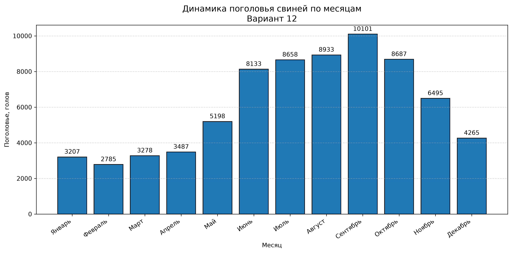
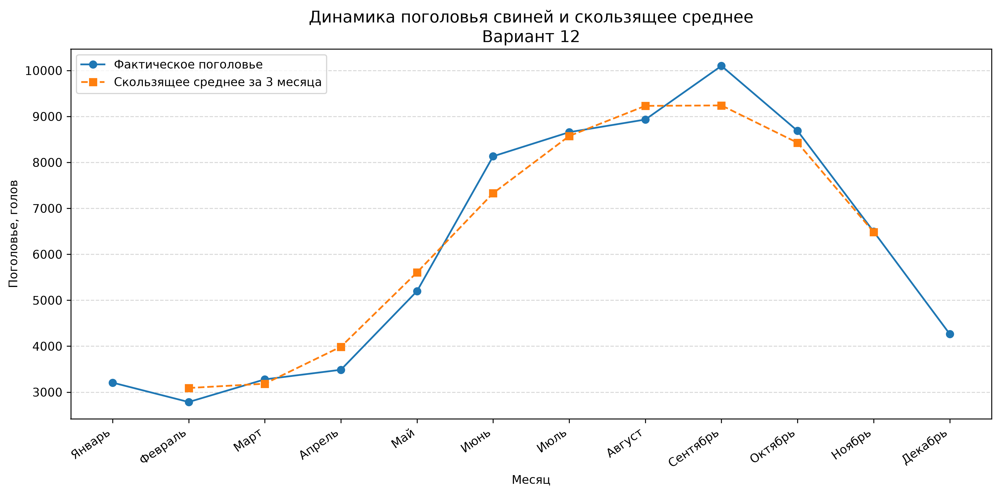

# Практическая работа № 3. Определение средней численности животных

## Цель работы

Рассчитать среднюю численность поголовья свиней за рассматриваемый период, проанализировать изменение показателя по месяцам и построить статистические диаграммы.

**Вариант:** 12  
**Год наблюдений:** 2025  
**Язык программирования:** Python

## Исходные данные

| Месяц | Поголовье, голов |
|---|---:|
| Январь | 3207 |
| Февраль | 2785 |
| Март | 3278 |
| Апрель | 3487 |
| Май | 5198 |
| Июнь | 8133 |
| Июль | 8658 |
| Август | 8933 |
| Сентябрь | 10101 |
| Октябрь | 8687 |
| Ноябрь | 6495 |
| Декабрь | 4265 |

## Методика расчёта

### Средняя арифметическая

Средняя арифметическая рассчитывается как сумма всех 12 значений, делённая на количество наблюдений:

\[
\overline{x}=\frac{\sum_{i=1}^{n}x_i}{n}
\]

где:
- \(x_i\) — значение поголовья;
- \(n\) — количество наблюдений.

Полученный результат: **6102,25 головы**.

### Средняя хронологическая взвешенная

Для наблюдений в начале месяца при неравных интервалах используется взвешивание средних значений соседних наблюдений по продолжительности интервалов:

\[
\overline{x}_{хр}=
\frac{\sum_{i=1}^{n-1}\left(\frac{x_i+x_{i+1}}{2}\right)\Delta t_i}
{\sum_{i=1}^{n-1}\Delta t_i}
\]

где:
- \(x_i\) и \(x_{i+1}\) — значения поголовья на соседних наблюдениях;
- \(\Delta t_i\) — продолжительность интервала в днях.

В расчёте используются 11 интервалов между январским и декабрьским наблюдениями общей продолжительностью **334 дня**.

Результат: **6340,16 головы**.

**Допущение:** наблюдения рассматриваются как моментные значения на начало каждого месяца, а между ними предполагается линейное изменение поголовья. Это допущение необходимо учитывать при интерпретации результата.

## Анализ динамики

Программа рассчитывает абсолютное и относительное изменение поголовья по сравнению с предыдущим месяцем, а также трёхмесячное скользящее среднее.

По исходным данным:
- минимальное поголовье — 2785 голов в феврале;
- максимальное поголовье — 10101 голова в сентябре;
- с лета до начала осени наблюдается рост показателя;
- после сентября поголовье снижается.

Данные за один год позволяют описать наблюдаемую динамику, но недостаточны для надёжного подтверждения повторяющейся сезонной компоненты. Для такого вывода необходимо сравнить данные за несколько лет.

## Структура проекта

```text
practical-work-3/
├── main.py
├── requirements.txt
├── README.md
├── .gitignore
└── results/
    ├── analysis_results.xlsx
    ├── pig_population_by_month.png
    └── moving_average.png
```

## Требования

- Python 3.14 или совместимая версия Python 3.
- Библиотеки, перечисленные в `requirements.txt`.

## Установка и запуск

Перейдите в каталог проекта:

```bash
cd practical-work-3
```

Создайте виртуальное окружение:

```bash
python3 -m venv .venv
```

Активируйте его в Ubuntu/Linux:

```bash
source .venv/bin/activate
```

Установите зависимости:

```bash
python -m pip install -r requirements.txt
```

Запустите программу:

```bash
python main.py
```

После выполнения программа выводит расчёты в терминал и сохраняет результаты в каталоге `results/`.

## Результаты работы

### Столбчатая диаграмма поголовья по месяцам



### Динамика поголовья и скользящее среднее



### Итоговая таблица

Файл `results/analysis_results.xlsx` содержит четыре листа:

1. **Исходные данные** — исходные значения поголовья.
2. **Расчёт средней** — продолжительность интервалов и расчёт взвешенной средней.
3. **Динамика** — изменения поголовья и скользящее среднее.
4. **Выводы** — итоговые показатели и принятые допущения.

## Вывод

В ходе работы рассчитаны средняя арифметическая и средняя хронологическая взвешенная численности поголовья свиней. Выполнен анализ изменения показателя по месяцам, построены диаграммы и сформирована итоговая электронная таблица.

Максимальное значение поголовья зафиксировано в сентябре, минимальное — в феврале. Для подтверждения наличия сезонной компоненты необходимо дополнительно исследовать данные за несколько лет.