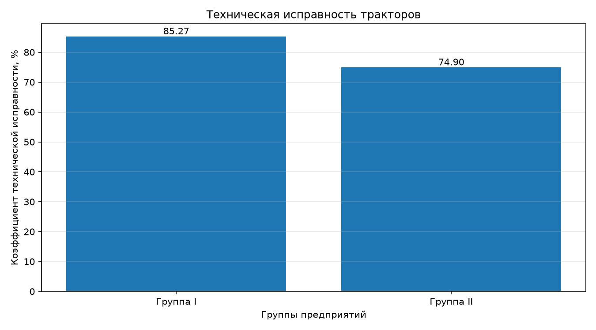
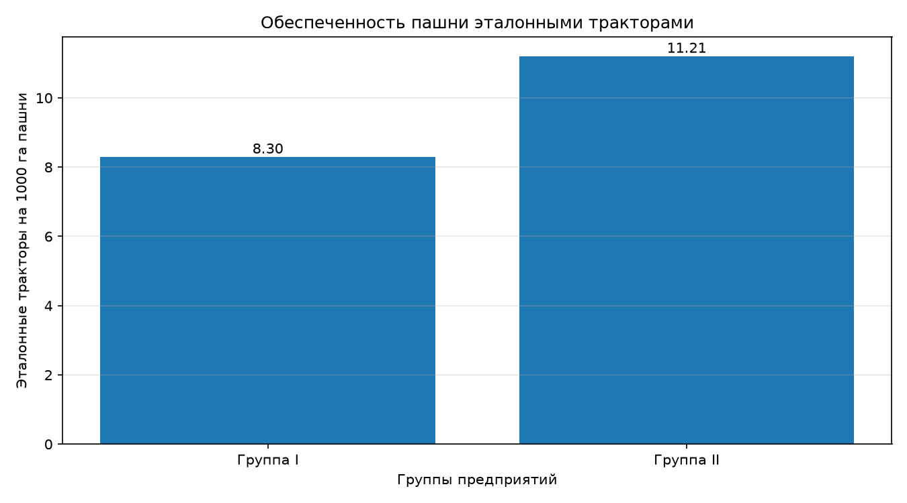
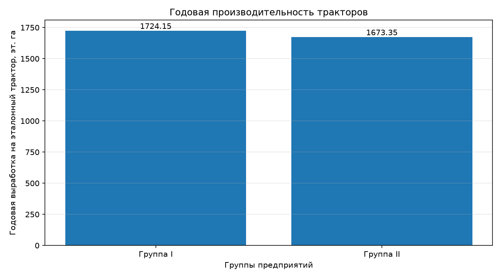
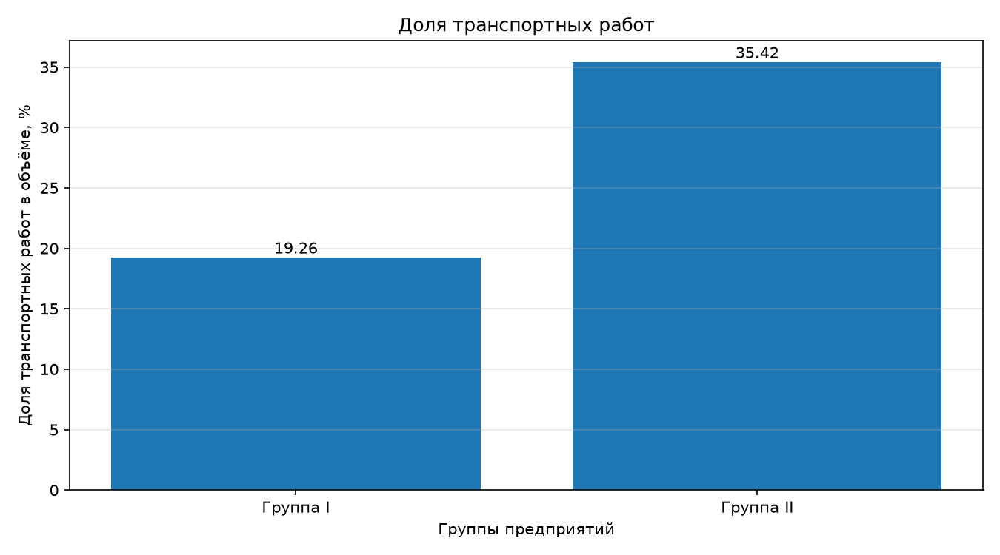
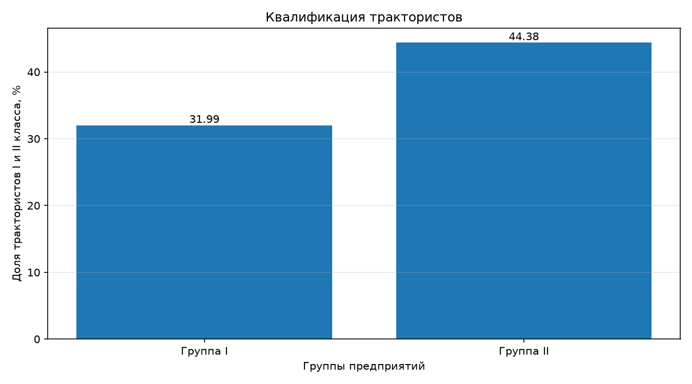

# Практическая работа № 4. Расчёт и анализ показателей использования тракторного парка

**Вариант:** 12  
**Направление:** анализ сельскохозяйственной статистики  
**Инструменты:** Python, pandas, matplotlib

## 1. Цель работы

Рассчитать систему показателей использования тракторного парка для двух групп предприятий, провести сравнительный анализ технического состояния, обеспеченности техникой, интенсивности использования, производительности и кадрового обеспечения, а также сформулировать выводы по результатам расчётов.

## 2. Исходные данные

Исходные данные содержат показатели двух групп предприятий. Группы I и II представляют разные совокупности предприятий, а не разные периоды времени.

| Показатель | Группа I | Группа II |
|---|---:|---:|
| Среднесписочное число физических тракторов, всего | 509 | 717 |
| В том числе исправных | 434 | 537 |
| Эталонных тракторов | 414 | 743 |
| Эталонные машино-смены | 96 772 | 170 618 |
| Эталонные машино-дни | 90 138 | 176 887 |
| В том числе машино-дни на транспортных работах | 25 543 | 69 141 |
| Выполнено эталонных нормосмен | 71 430 | 163 973 |
| Объём выполненных работ, тыс. эталонных га | 713,8 | 1 243,3 |
| В том числе транспортные работы, тыс. эталонных га | 137,5 | 440,4 |
| Среднесписочное число трактористов-машинистов, чел. | 572 | 676 |
| В том числе I и II класса | 183 | 300 |
| Площадь пашни, тыс. га | 49,9 | 66,3 |
| Балансовая стоимость тракторов, млн руб. | 746 | 1 103 |
| Балансовая стоимость сельскохозяйственных машин, млн руб. | 1 019 | 1 416 |

Физический трактор — фактически имеющаяся машина. Эталонный трактор — условная единица, позволяющая сопоставлять тракторы с различной производительностью. Эталонный гектар характеризует условный объём механизированных работ и не равен обычному гектару площади пашни.

## 3. Методика расчёта

Программа рассчитывает 19 показателей, объединённых по направлениям анализа.

### 3.1. Техническое состояние и обеспеченность техникой

1. Коэффициент технической исправности — отношение числа исправных тракторов к общему числу физических тракторов.
2. Коэффициент перевода физических тракторов в эталонные — отношение числа эталонных тракторов к числу физических.
3. Количество эталонных тракторов на 1 000 га пашни.
4. Нагрузка пашни на один эталонный трактор, га.

### 3.2. Использование тракторного парка

5. Количество машино-дней на один эталонный трактор.
6. Использование календарного фонда времени.
7. Коэффициент сменности — отношение эталонных машино-смен к эталонным машино-дням.
8. Количество выполненных нормосмен на одну машино-смену.

### 3.3. Производительность

9. Годовая выработка на один эталонный трактор.
10. Выработка на один машино-день.
11. Выработка на одну машино-смену.

### 3.4. Транспортные работы

12. Доля транспортных работ в общем объёме выполненных работ.
13. Доля транспортных машино-дней в общем количестве машино-дней.

### 3.5. Кадровое обеспечение

14. Количество трактористов-машинистов на один физический трактор.
15. Доля трактористов-машинистов I и II класса.
16. Выработка на одного тракториста-машиниста.

### 3.6. Стоимость техники

17. Балансовая стоимость тракторов на один эталонный трактор.
18. Балансовая стоимость сельскохозяйственных машин на один эталонный трактор.
19. Совокупная балансовая стоимость тракторов и сельскохозяйственных машин на один эталонный трактор.

## 4. Результаты расчётов

Программа автоматически рассчитывает показатели для обеих групп, определяет абсолютную разницу между ними и отношение показателя группы II к показателю группы I.

Полная сравнительная таблица сохраняется в файле `comparison.csv`, а значения рассчитанных показателей — в `results.csv`.

### 4.1. Сравнительная таблица ключевых показателей

| Показатель | Группа I | Группа II |
|---|---:|---:|
| Техническая исправность, % | 85,27 | 74,90 |
| Эталонные тракторы на 1 000 га пашни | 8,30 | 11,21 |
| Нагрузка пашни на эталонный трактор, га | 120,53 | 89,23 |
| Машино-дни на эталонный трактор | 217,72 | 238,07 |
| Использование календарного фонда, % | 59,65 | 65,23 |
| Коэффициент сменности | 1,07 | 0,96 |
| Нормосмены на одну машино-смену | 0,74 | 0,96 |
| Годовая выработка на эталонный трактор, эт. га | 1 724,15 | 1 673,35 |
| Выработка на один машино-день, эт. га | 7,92 | 7,03 |
| Выработка на одну машино-смену, эт. га | 7,38 | 7,29 |
| Доля транспортных работ, % | 19,26 | 35,42 |
| Доля транспортных машино-дней, % | 28,34 | 39,09 |
| Трактористов на один физический трактор | 1,12 | 0,94 |
| Трактористы I и II класса, % | 31,99 | 44,38 |
| Выработка на одного тракториста, эт. га | 1 247,90 | 1 839,20 |
| Стоимость тракторов на эталонный трактор, млн руб. | 1,80 | 1,48 |
| Стоимость сельхозмашин на эталонный трактор, млн руб. | 2,46 | 1,91 |
| Совокупная стоимость техники на эталонный трактор, млн руб. | 4,26 | 3,39 |

*Примечание: значения округлены для отображения. В расчётах используются исходные значения без предварительного округления.*

## 5. Визуализация результатов

Для наглядного сравнения групп предприятий построены пять столбчатых диаграмм.

### 5.1. Техническая исправность тракторного парка



График показывает долю исправных физических тракторов в каждой группе предприятий.

### 5.2. Обеспеченность тракторного парка



Диаграмма позволяет сравнить обеспеченность пашни эталонными тракторами в двух группах предприятий.

### 5.3. Производительность тракторного парка



На графике представлены показатели производительности, позволяющие сопоставить результаты использования тракторного парка.

### 5.4. Использование тракторов на транспортных работах



Диаграмма отражает различия в доле транспортных работ в общем объёме выполненных работ.

### 5.5. Квалификация трактористов-машинистов



График показывает долю трактористов-машинистов I и II класса в каждой группе предприятий.

## 6. Анализ и выводы

По результатам расчётов можно выделить следующие особенности двух групп предприятий.

**Техническое состояние.** В группе I коэффициент технической исправности составляет 85,27%, а в группе II — 74,90%. Таким образом, в первой группе доля исправных физических тракторов выше.

**Обеспеченность техникой.** В группе II приходится 11,21 эталонного трактора на 1 000 га пашни, тогда как в группе I — 8,30. Нагрузка пашни на один эталонный трактор в группе II ниже.

**Использование и производительность.** Группа II имеет большее количество машино-дней на один эталонный трактор и более высокий показатель использования календарного фонда. При этом годовая выработка на один эталонный трактор немного выше в группе I: 1 724,15 эт. га против 1 673,35 эт. га.

**Транспортные работы.** Доля транспортных работ в общем объёме в группе II составляет 35,42%, а в группе I — 19,26%. Это указывает на различия в структуре выполняемых работ.

**Кадровое обеспечение.** Доля трактористов-машинистов I и II класса выше в группе II: 44,38% против 31,99%. Также в группе II выше выработка на одного тракториста-машиниста.

**Стоимость техники.** Совокупная балансовая стоимость тракторов и сельскохозяйственных машин в расчёте на один эталонный трактор ниже в группе II.

### Особенности интерпретации

Коэффициент сменности в группе II составляет 0,96, то есть меньше единицы. Это необычное соотношение количества машино-смен и машино-дней. Исходные данные не изменялись; показатель следует дополнительно проверить по первоисточнику и методике расчёта.

При расчёте использования календарного фонда применено условное значение 365 дней в году. Его использование необходимо сверить с требованиями практикума.

Доля транспортных работ в объёме выполненных работ и доля транспортных машино-дней характеризуют разные стороны деятельности, поэтому эти показатели не следует отождествлять.

### Общий вывод

Сравнение показывает, что группы предприятий различаются по техническому состоянию тракторного парка, обеспеченности техникой, производительности, структуре выполняемых работ и кадровому составу.

Группа I характеризуется более высокой долей исправных тракторов и несколько большей годовой выработкой на один эталонный трактор. Группа II имеет более высокую обеспеченность пашни эталонными тракторами, большую долю квалифицированных трактористов и более высокую выработку на одного тракториста-машиниста.

По совокупности рассмотренных показателей нельзя однозначно признать одну группу эффективнее другой: результаты зависят от выбранного критерия оценки.

## 7. Используемые технологии

- **Python** — язык программирования, использованный для автоматизации расчётов.
- **pandas** — загрузка, проверка, обработка и сохранение табличных данных.
- **matplotlib** — построение диаграмм и визуализация результатов.

## 8. Структура проекта

```text
practical-work-4/
├── data/
│   └── tractor_data.csv
├── charts/
│   ├── technical_condition.png
│   ├── tractor_supply.png
│   ├── productivity.png
│   ├── transport_work.png
│   └── qualified_drivers.png
├── main.py
├── results.csv
├── comparison.csv
├── README.md
└── .gitignore
```

Виртуальное окружение `.venv` создаётся локально и не включается в репозиторий.

## 9. Запуск программы

Для запуска необходим установленный Python и библиотеки pandas и matplotlib.

В терминале из каталога проекта:

```bash
source .venv/bin/activate
python main.py
```

После выполнения программа:

1. Загружает исходные данные из `data/tractor_data.csv`.
2. Проверяет наличие необходимых показателей и корректность значений.
3. Рассчитывает систему показателей для обеих групп предприятий.
4. Формирует сравнительную таблицу.
5. Сохраняет результаты в CSV-файлы.
6. Строит и сохраняет диаграммы в каталоге `charts/`.
7. Выводит сравнительный анализ и основные выводы в терминал.

## 10. Итог

В ходе практической работы была реализована программа на Python для расчёта и сравнительного анализа показателей использования тракторного парка двух групп предприятий. Выполнены проверки исходных данных, рассчитаны аналитические показатели, сформирована сравнительная таблица и построены графики.

Полученные результаты позволяют оценить различия между группами предприятий по техническому состоянию, обеспеченности тракторами, производительности, транспортным работам и кадровому обеспечению.