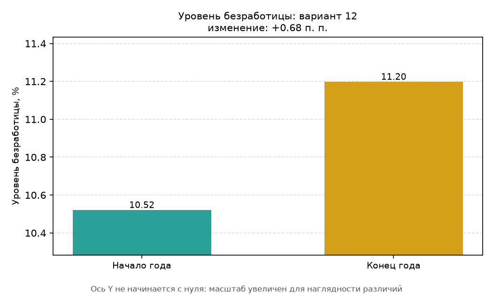
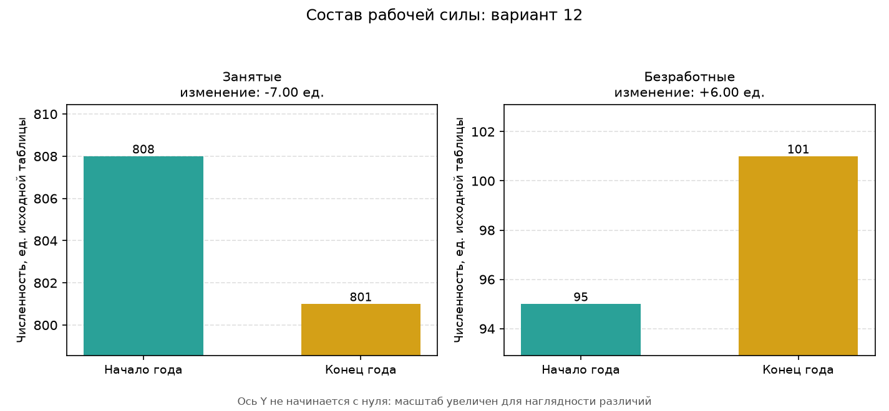
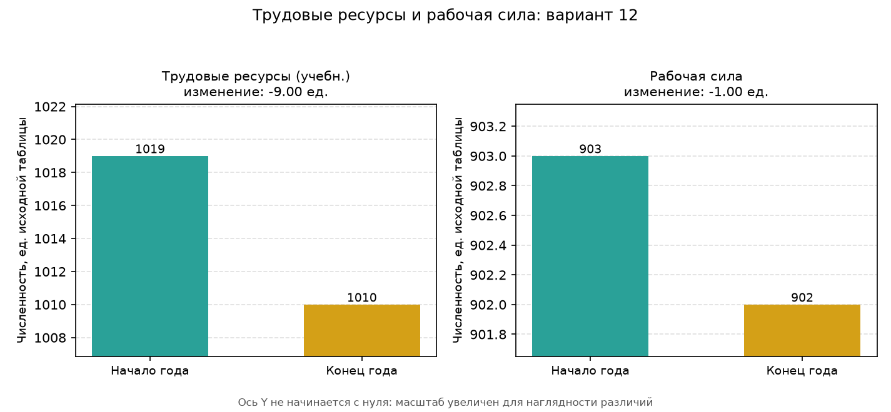
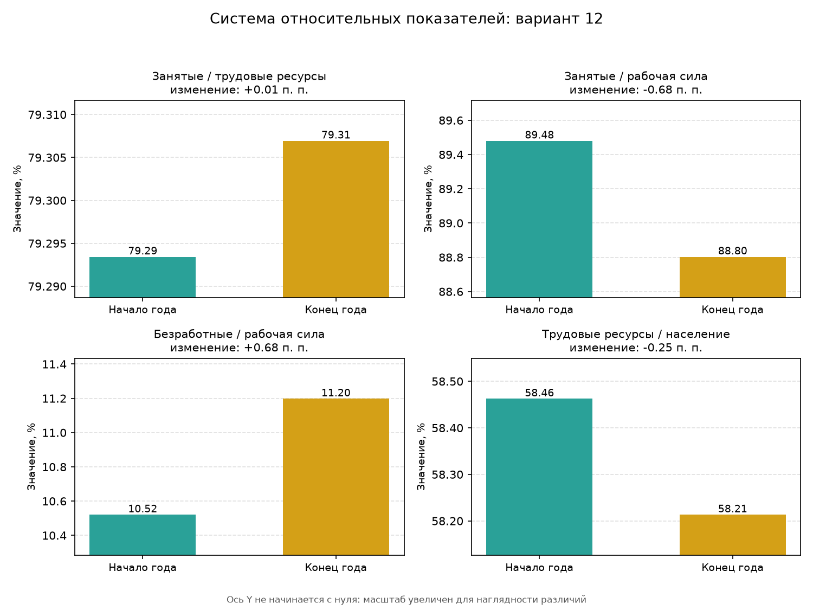
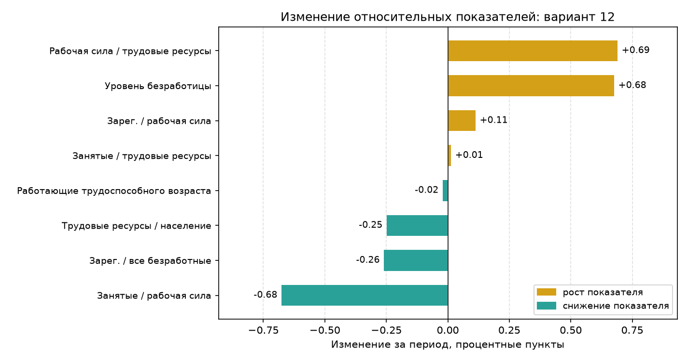

# Практическая работа № 5 — Расчёт показателей наличия и занятости трудовых ресурсов

Расчёт системы показателей наличия и занятости трудовых ресурсов по учебному набору данных, сопоставление значений на начало и конец года, визуализация результатов и статистический вывод.

**Вариант:** 12  
**Дисциплина:** сельскохозяйственная статистика  
**Инструменты:** Python, pandas, matplotlib

## 🎯 Цель работы

Определить численность трудовых ресурсов по учебной расчётной схеме, рассчитать рабочую силу и относительные показатели занятости и безработицы, сопоставить начало и конец периода, представить расчёт, визуализацию и обоснованный вывод.

## 📥 Исходные данные

Все количества приведены в единицах исходной таблицы. Календарный год и размерность в источнике не указаны.

| Показатель | На начало года | На конец года |
|---|---:|---:|
| Постоянное население — всего | 1743 | 1735 |
| в трудоспособном возрасте | 970 | 961 |
| в пенсионном возрасте до 72 лет | 299 | 299 |
| неработающие инвалиды I и II групп и льготные пенсионеры (в трудоспособном возрасте) | 13 | 14 |
| Занятые в экономике — всего | 808 | 801 |
| в том числе в пенсионном возрасте до 72 лет | 58 | 59 |
| в том числе подростки в возрасте 15 лет и старше | 4 | 4 |
| Безработные — всего | 95 | 101 |
| в том числе в пенсионном возрасте до 72 лет | 5 | 5 |
| Из числа безработных зарегистрировано в органах службы занятости | 20 | 21 |

Категории «в том числе» входят в соответствующие итоги и повторно не суммируются. Строка «население в пенсионном возрасте до 72 лет» приведена справочно и в расчёте трудовых ресурсов не участвует.

## 🧮 Методика расчёта

### Абсолютные показатели

```text
T = A − I + P + M      трудовые ресурсы (учебная схема)
L = E + U              рабочая сила
```

где `A` — население в трудоспособном возрасте, `I` — неработающие инвалиды I и II групп и льготные пенсионеры, `P` — работающие лица пенсионного возраста, `M` — работающие подростки, `E` — занятые, `U` — безработные.

Дополнительно рассчитаны:

```text
Занятые в трудоспособном возрасте    = E − P − M
Безработные вне пенсионного возраста = U − U(пенсионного возраста)
```

### Относительные показатели

| Показатель | Формула |
|---|---|
| Уровень безработицы, % | U / L × 100 |
| Зарегистрированные / все безработные, % | R / U × 100 |
| Занятые / трудовые ресурсы, % | E / T × 100 |
| Занятые / рабочая сила, % | E / L × 100 |
| Трудовые ресурсы / население, % | T / N × 100 |
| Зарегистрированные / рабочая сила, % | R / L × 100 |
| Рабочая сила / трудовые ресурсы, % | L / T × 100 |
| Работающие трудоспособного возраста, % | (E − P − M) / (A − I) × 100 |

Знаменатель уровня безработицы — рабочая сила, а не всё постоянное население. Изменение относительных показателей измеряется в процентных пунктах (п. п.) и вычисляется по неокруглённым значениям, округляется только результат.

## 📚 Выполненные задания

### Задание 1 — Загрузка и проверка исходных данных

Данные варианта 12 перенесены в `data/variant12.csv` с сохранением структуры строк исходного листа, включая служебные строки «В том числе:». Благодаря этому нумерация строк из методических материалов сохраняется, и функция `value(excel_row, col)` обращается к тем же позициям через `df.iloc[excel_row - 2, col]`.

Перед расчётами выполняются проверки: наличие файла, количество колонок и строк, преобразование значений в числа, контроль пропусков и отрицательных значений, логические ограничения.

### Задание 2 — Расчёт системы показателей

Одна функция `calc()` применяется к данным начала и конца периода. Рассчитаны 4 абсолютных расчётных показателя и 8 относительных показателей.

### Задание 3 — Сравнительная таблица

Сформирована таблица «Начало — Конец — Изменение» по 20 позициям. Результаты сохранены в `results.csv`, относительные показатели отдельно — в `indicators.csv` (кодировка `utf-8-sig` для корректного открытия в Excel).

### Задание 4 — Визуализация

Построены пять подписанных диаграмм: две обязательные (уровень безработицы, состав рабочей силы) и три дополнительные (трудовые ресурсы и рабочая сила, система относительных показателей, изменение показателей в процентных пунктах).

### Задание 5 — Контроль вычислений и вывод

Реализованы логические проверки исходных данных и самопроверка формул. Сформулирован вывод с числовыми аргументами и указанием методических ограничений.

## 📊 Результаты расчёта

### Абсолютные показатели

| Показатель | Начало | Конец | Изменение |
|---|---:|---:|---:|
| Постоянное население | 1743 | 1735 | −8 |
| Население в трудоспособном возрасте | 970 | 961 | −9 |
| Неработающие инвалиды и льготные пенсионеры | 13 | 14 | +1 |
| Занятые, всего | 808 | 801 | −7 |
| Занятые пенсионного возраста | 58 | 59 | +1 |
| Работающие подростки | 4 | 4 | 0 |
| Безработные, всего | 95 | 101 | +6 |
| Зарегистрированные безработные | 20 | 21 | +1 |
| **Трудовые ресурсы (учебн.)** | **1019** | **1010** | **−9** |
| **Рабочая сила** | **903** | **902** | **−1** |
| Занятые в трудоспособном возрасте | 746 | 738 | −8 |
| Безработные вне пенсионного возраста | 90 | 96 | +6 |

### Относительные показатели

| Показатель | Начало, % | Конец, % | Разница, п. п. |
|---|---:|---:|---:|
| Уровень безработицы | 10,52 | 11,20 | +0,68 |
| Зарегистрированные / все безработные | 21,05 | 20,79 | −0,26 |
| Занятые / трудовые ресурсы | 79,29 | 79,31 | +0,01 |
| Занятые / рабочая сила | 89,48 | 88,80 | −0,68 |
| Трудовые ресурсы / население | 58,46 | 58,21 | −0,25 |
| Зарегистрированные / рабочая сила | 2,21 | 2,33 | +0,11 |
| Рабочая сила / трудовые ресурсы | 88,62 | 89,31 | +0,69 |
| Работающие трудоспособного возраста | 77,95 | 77,93 | −0,02 |

## 📈 Графическое представление

### Уровень безработицы



### Состав рабочей силы



### Трудовые ресурсы и рабочая сила



### Система относительных показателей



### Изменение относительных показателей



### Пояснение к выбору масштаба

Абсолютные изменения в наборе малы относительно самих значений: например, численность занятых изменилась на 0,9 %, а отношение занятых к трудовым ресурсам — на 0,02 % от величины показателя. При шкале от нуля такие различия визуально не читаются.

Поэтому на столбчатых диаграммах границы оси Y подбираются вокруг данных функцией `zoom_limits()` с отступом 35 % от размаха значений. Показатели разного порядка величины (занятые и безработные, трудовые ресурсы и рабочая сила) разнесены на отдельные панели со собственными шкалами. На каждой такой диаграмме явно указано, что ось Y не начинается с нуля.

Приближенная шкала показывает направление изменения, но не его существенность. Для корректной оценки величины изменений предназначена диаграмма `changes.png`: она построена от нулевой базы и показывает разницу в процентных пунктах. Величина изменения также приведена числовой подписью на каждой панели.

Бирюзовый цвет — начало года, золотой — конец года.

## ✅ Контроль корректности

Проверки исходных данных (для каждого периода):

- население в трудоспособном возрасте не превышает постоянное население;
- исключаемые категории не превышают трудоспособное население;
- работающие пенсионеры и подростки не превышают общую численность занятых;
- безработные пенсионного возраста не превышают общую численность безработных;
- зарегистрированные безработные не превышают общую численность безработных;
- рабочая сила не превышает постоянное население;
- знаменатели относительных показателей не равны нулю.

Самопроверка формул:

- `L = E + U` для обоих периодов;
- `E / L × 100 + U / L × 100 = 100 %`.

Все проверки пройдены. Результаты дополнительно сверены с независимым расчётом по тем же формулам, методика предварительно воспроизведена на эталонном варианте 1.

## 💡 Выводы

1. Численность занятых сократилась с 808 до 801 (−7), численность безработных выросла с 95 до 101 (+6). Рабочая сила изменилась всего на −1 единицу: её общий объём практически сохранился, а структура сдвинулась в сторону безработицы.
2. Уровень безработицы вырос с 10,52 % до 11,20 % (+0,68 п. п.). Доля занятых в рабочей силе снизилась на 0,68 п. п., что является зеркальным отражением того же изменения.
3. Зарегистрированных безработных стало больше (20 → 21, +1), однако их доля среди всех безработных снизилась с 21,05 % до 20,79 % (−0,26 п. п.). Это не арифметическое противоречие: общая безработица росла быстрее административного учёта, показатели описывают разные совокупности наблюдения.
4. Трудовые ресурсы по учебной схеме сократились с 1019 до 1010 (−9). По данным это связано с уменьшением населения в трудоспособном возрасте на 9 и ростом исключаемых категорий на 1, частично компенсированными ростом числа работающих пенсионеров на 1. Доля трудовых ресурсов в постоянном населении снизилась на 0,25 п. п.
5. Отношение занятых к трудовым ресурсам практически не изменилось (+0,01 п. п.): занятые и трудовые ресурсы сокращались почти пропорционально. При этом отношение рабочей силы к трудовым ресурсам выросло на 0,69 п. п., поскольку трудовые ресурсы уменьшались быстрее рабочей силы.

## ⚠️ Методические ограничения

- Формула `T = A − I + P + M` — упрощённая учебная схема, а не полный официальный баланс трудовых ресурсов; данные о трудовых мигрантах отсутствуют.
- Календарный год и единицы измерения численности в источнике не указаны.
- Возрастные границы отдельных категорий сформулированы неоднозначно; работающие подростки учтены как лица вне трудоспособного возраста. Допущение требует сверки с полной методикой.
- Занятые в трудоспособном возрасте вычислены условно, при предположении, что категории не пересекаются.
- Показатели «занятые / трудовые ресурсы», «трудовые ресурсы / население», «рабочая сила / трудовые ресурсы» — учебные отношения, они не подменяют официальные показатели уровня занятости и участия в рабочей силе.
- Приближенная шкала оси Y на столбчатых диаграммах визуально усиливает различия. Существенность изменений оценивается по числовым значениям и по диаграмме изменений в процентных пунктах, а не по высоте столбцов.
- Индивидуальные варианты не являются статистической выборкой регионов. Значения нельзя использовать как фактические показатели конкретной территории.
- Причины изменений по исходной таблице не устанавливаются.

## 🗂️ Структура проекта

```text
practical-work-5/
├── .venv/                      # виртуальное окружение (не в Git)
├── data/
│   └── variant12.csv           # исходные данные варианта 12
├── charts/
│   ├── unemployment_rate.png   # уровень безработицы
│   ├── workforce_structure.png # состав рабочей силы
│   ├── labour_resources.png    # трудовые ресурсы и рабочая сила
│   ├── coefficients.png        # система относительных показателей
│   └── changes.png             # изменение показателей, п. п.
├── main.py                     # загрузка, проверки, расчёт, графики, выводы
├── results.csv                 # сводная таблица: начало / конец / изменение
├── indicators.csv              # относительные показатели, %
├── requirements.txt            # зафиксированные версии зависимостей
├── .gitignore
└── README.md
```

## 🚀 Запуск

```bash
# создание и активация виртуального окружения
python3 -m venv .venv
source .venv/bin/activate

# установка зависимостей
pip install -r requirements.txt

# запуск расчёта
python main.py
```

Программа выводит сводную таблицу и аналитические выводы в консоль, сохраняет `results.csv`, `indicators.csv` и пять диаграмм в папку `charts/`.

## 🛠️ Используемые технологии

- **Python 3.14** — основной язык;
- **pandas 3.1.1** — чтение данных, проверки, сводная таблица, экспорт CSV;
- **matplotlib 3.11.2** — построение диаграмм; backend `Agg` задаётся через `plt.switch_backend()` после импортов, графики сохраняются в файлы без открытия окон.

## 📚 Источники

1. Методические указания: «ПЗ 5. Расчёт показателей наличия и занятости трудовых ресурсов».
2. Методические материалы к практическому занятию (презентация с разбором варианта 1).
3. Эталон расчётов по варианту 1 — использован для сверки методики.
4. Росстат. Трудовые ресурсы, занятость и безработица.
5. Росстат. Методика расчёта баланса трудовых ресурсов (приказ № 647 от 29.09.2017).
6. МОТ. Резолюция о статистике труда, занятости и недоиспользовании рабочей силы (2013 г.).

**Ограничения источников:** текст задачи 10.9 Практикума, на которую ссылается методичка, не предоставлен. Исходный файл «Население_30_вариантов_простой» также не предоставлен, поэтому данные варианта 12 перенесены в CSV вручную с сохранением структуры строк, а чтение выполняется через `pandas.read_csv` вместо `read_excel`. Полное соответствие каждой формулировки оригинальному практикуму не подтверждено.

---

*Практическая работа является частью учебного репозитория по дисциплине «Сельскохозяйственная статистика».*