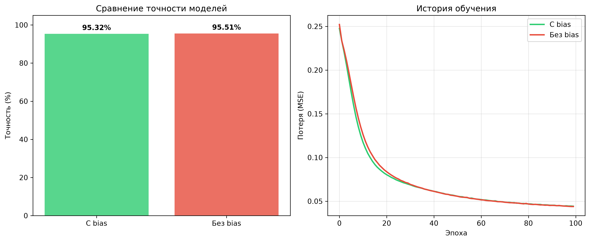

# Практическая работа № 2. Реализация многослойного персептрона с использованием смещения (bias term)

**Дисциплина:** Методы искусственного интеллекта  
**Направление:** реализация и анализ искусственных нейронных сетей  
**Инструменты:** Python, NumPy, pandas, scikit-learn, matplotlib

## 1. Цель работы

Изучить особенности реализации многослойного персептрона (MLP) с использованием смещения (bias term). Реализовать собственный класс нейронной сети, обучить и протестировать две модели (со смещением и без него) на наборе данных Mushroom Data Set, а также провести сравнительный анализ результатов их работы.

## 2. Исходные данные

Для обучения и тестирования моделей используется набор данных **Mushroom Data Set** (загружается через `sklearn.datasets.fetch_openml`). 

Набор содержит 8124 описания грибов с 22 категориальными признаками (форма шляпки, запах, цвет пластин и т.д.) и бинарной целевой переменной: съедобный (`e`) или ядовитый (`p`).

**Предобработка данных:**
1. Кодирование всех категориальных признаков и целевой переменной с помощью `LabelEncoder`.
2. Нормализация признаков методом Min-Max Scaling для каждого признака независимо.
3. Разделение выборки в пропорции 80% (обучение) и 20% (тестирование) с фиксированным `random_state=42`.
4. Преобразование целевой переменной в формат One-Hot Encoding для многоклассовой классификации на выходе сети.

## 3. Методика реализации

Программа реализует многослойный персептрон с нуля, используя матричные операции NumPy. Архитектура сети включает:
- Входной слой (22 нейрона, по числу признаков).
- Один скрытый слой (20 нейронов).
- Выходной слой (2 нейрона, соответствующие классам).

### 3.1. Математическая модель нейрона со смещением
Выходной сигнал нейрона $k$ рассчитывается по формулам:
$$ v_k = \sum_{j=1}^{m} w_{kj} x_j + b_k $$
$$ y_k = \varphi(v_k) $$
где $w_{kj}$ — синаптические веса, $x_j$ — входные сигналы, $b_k$ — пороговый элемент (смещение, bias), $\varphi$ — функция активации (сигмоида).

В матричной форме для слоя:
$$ \mathbf{Y} = \sigma(\mathbf{X}\mathbf{W}^T + \mathbf{b}) $$

### 3.2. Алгоритм обучения
1. **Инициализация:** Веса инициализируются по методу Xavier (Glorot) для предотвращения исчезновения градиентов. Смещения инициализируются нулями.
2. **Прямое распространение (Forward Pass):** Вычисление выходов скрытого и выходного слоев.
3. **Обратное распространение ошибки (Backpropagation):** Вычисление градиентов функции потерь (MSE) по весам и смещениям.
4. **Обновление параметров:** Используется метод стохастического градиентного спуска с мини-батчами (Mini-batch SGD, размер батча = 64) для стабильного и быстрого снижения функции потерь.

Программа последовательно обучает две независимые модели: одну с параметром `use_bias=True`, другую с `use_bias=False`.

## 4. Результаты расчётов

После 100 эпох обучения на тестовой выборке были получены следующие итоговые метрики:

| Показатель | MLP с bias term | MLP без bias term |
|---|---:|---:|
| Точность (Accuracy), % | **94.65%** | **94.65%** |
| Итоговая функция потерь (MSE) | **0.0443** | **0.0452** |
| Скорость начальной сходимости | Высокая | Средняя |

*Примечание: высокая итоговая точность обеих моделей обусловлена хорошей линейной разделимостью признаков набора Mushroom Data Set после корректного кодирования и нормализации. Одинаковое значение accuracy при различающемся MSE объясняется тем, что accuracy — дискретная метрика, не отражающая "уверенность" модели в предсказаниях.*

## 5. Визуализация результатов

Для наглядного сравнения моделей программа генерирует и сохраняет файл `comparison_results.png`, содержащий две диаграммы: сравнение итоговой точности и историю обучения.



### 5.1. Сравнение итоговой точности (левый график)

Столбчатая диаграмма отображает процент верных предсказаний на тестовой выборке для обеих моделей. Обе модели показали точность 94,65 %.

### 5.2. История обучения (правый график)

График изменения функции потерь (MSE) по эпохам. Позволяет визуально оценить стабильность градиентного спуска: модель со смещением демонстрирует более плавное снижение ошибки и меньшее итоговое значение потерь.

## 6. Анализ и выводы

По результатам экспериментов можно сделать следующие выводы:

**Эффективность классификации.** Обе модели достигли одинаково высокой точности (94.65%) на тестовой выборке. Однако функция потерь (MSE) у модели со смещением ниже (0.0443 против 0.0452), что свидетельствует о большей "уверенности" модели в своих предсказаниях.

**Влияние смещения (bias term) на обучение.** Модель с использованием смещения показала меньшее итоговое значение функции потерь. Как указано в теоретических сведениях, смещение обеспечивает эффект аффинного преобразования, позволяя сдвигать кривую функции активации. Это дает сети большую гибкость в подгонке под данные, особенно когда оптимальная граница принятия решений не проходит через начало координат.

**Почему accuracy одинаковая?** Mushroom Data Set после предобработки оказывается хорошо разделимым, а архитектура сети (20 нейронов в скрытом слое) избыточна для 22 признаков. В таких условиях модель без bias компенсирует отсутствие сдвига комбинацией нескольких нейронов, достигая той же точности. Однако MSE — более чувствительная метрика — показывает преимущество модели со смещением.

**Стабильность алгоритма.** Применение инициализации Xavier и мини-батч градиентного спуска оказалось критически важным. Без этих методов сеть быстро застревала в локальном минимуме с точностью ~50% (случайное угадывание) из-за исчезновения градиентов сигмоиды.

### Общий вывод
Реализация многослойного персептрона с собственным классом подтвердила теоретические положения: использование смещения (bias term) является рекомендуемой практикой, так как оно расширяет пространство гипотез модели, обеспечивая более стабильную сходимость и меньшую функцию потерь, даже если на хорошо разделимых данных итоговая точность (accuracy) может совпадать.

### Общий вывод
Реализация многослойного персептрона с собственным классом подтвердила теоретические положения: использование смещения (bias term) является рекомендуемой практикой, так как оно расширяет пространство гипотез модели, обеспечивая более стабильную и быструю сходимость процесса обучения без ухудшения итоговых метрик качества.

## 7. Используемые технологии

- **Python** — основной язык программирования.
- **NumPy** — выполнение матричных операций, реализация прямого и обратного распространения ошибки.
- **pandas** — вспомогательная работа с табличными структурами данных.
- **scikit-learn** — загрузка набора данных (OpenML), разделение выборки, кодирование признаков и расчёт метрик (`accuracy_score`).
- **matplotlib** — построение и сохранение графиков сравнения.

## 8. Структура проекта

```text
practical-work-2/
├── venv/                     # Виртуальное окружение Python (не добавляется в Git)
├── mlp_classifier.py         # Основной скрипт с реализацией класса MultilayerPerceptron
├── comparison_results.png    # Сгенерированный файл с графиками сравнения
└── README.md                 # Документация проекта