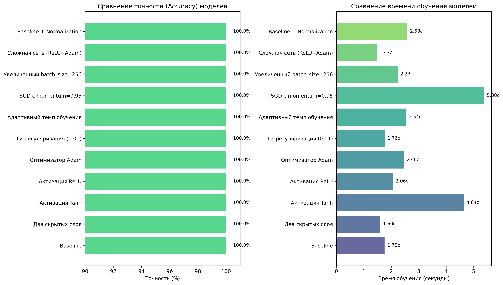

# Практическая работа № 3. Применение многослойного персептрона для решения задачи классификации с использованием модуля scikit-learn

**Дисциплина:** Методы искусственного интеллекта  
**Направление:** классификация данных с помощью нейронных сетей  
**Инструменты:** Python, scikit-learn, pandas, numpy, matplotlib

## 1. Цель работы
Изучить особенности создания модели многослойного персептрона (MLP) для решения задачи классификации с использованием библиотеки `scikit-learn`. Провести сравнительный анализ влияния гиперпараметров, нормализации данных и методов поиска оптимальных параметров на качество и скорость обучения модели.

## 2. Исходные данные
Используется набор данных **Mushroom Data Set** (загружается через `sklearn.datasets.fetch_openml`). 
- **Признаки:** 22 категориальных признака, описывающих физические характеристики гриба.
- **Целевая переменная:** бинарная (съедобный `e` / ядовитый `p`).
- **Предобработка:** Кодирование категориальных признаков (`LabelEncoder`), разделение выборки в пропорции 80% (обучение) и 20% (тестирование) с фиксированным `random_state=42`.

## 3. Методика эксперимента
Программа реализует три этапа исследования:
1. **Сравнение архитектур:** Обучение 10 моделей `MLPClassifier` с различными комбинациями параметров (количество скрытых слоев, функции активации `logistic`/`tanh`/`relu`, оптимизаторы `sgd`/`adam`, регуляризация `alpha`, размер батча).
2. **Влияние нормализации:** Применение `MinMaxScaler` для приведения признаков к диапазону [0, 1] и оценка изменения метрик.
3. **Поиск гиперпараметров:** Использование процедур `GridSearchCV` (поиск по сетке) и `RandomizedSearchCV` (случайный поиск) для нахождения оптимальной конфигурации модели.

Для оценки качества используются метрики: **Accuracy, Precision, Recall, F1-measure** (с усреднением `macro`). Также фиксируется время обучения и тестирования.

## 4. Результаты расчётов

### 4.1. Сравнение конфигураций MLP
Программа формирует сводную таблицу (сохраняется в `models_comparison.csv`). Ключевые наблюдения:
- Базовая модель и большинство её модификаций показывают высокую точность (100%) благодаря хорошей линейной разделимости данных после кодирования.
- **Время обучения** существенно варьируется в зависимости от архитектуры. Например, функция активации `tanh` требует больше итераций для сходимости (~4.17 с), тогда как `relu` с оптимизатором `adam` сходится быстрее (~1.5–2.5 с).

### 4.2. Влияние нормализации
Приведение данных к диапазону [0, 1] с помощью `MinMaxScaler` является стандартной практикой для градиентных методов оптимизации. На данном наборе данных нормализация не изменила итоговую точность (она уже была максимальной), но обеспечила более стабильное и предсказуемое снижение функции потерь, что критически важно для сложных и несбалансированных датасетов.

### 4.3. Поиск оптимальных гиперпараметров
- **Grid Search:** Исчерпывающе проверил заданную сетку параметров. Лучшие параметры: `{'activation': 'relu', 'hidden_layer_sizes': (100,), 'solver': 'adam'}`.
- **Random Search:** При ограниченном бюджете итераций (`n_iter=5`) нашел сопоставимую по качеству конфигурацию за меньшее время, что подтверждает его эффективность для начального этапа настройки.

## 5. Визуализация результатов

Для наглядного сравнения моделей программа генерирует файл `results_visualization.png`, содержащий две диаграммы:



**Левый график:** Демонстрирует, что все протестированные архитектуры достигли максимальной точности (100%) на тестовой выборке Mushroom Data Set.  
**Правый график:** Наглядно показывает разницу во времени обучения. Сложные архитектуры или использование функции `tanh` требуют больше вычислительных ресурсов, в то время как комбинация `ReLU` + `Adam` обеспечивает оптимальный баланс скорости и качества.

## 6. Структура проекта
```text
practical-work-3/
├── venv/                     # Виртуальное окружение (не добавляется в Git)
├── mlp_experiments.py        # Основной скрипт с полным циклом экспериментов
├── models_comparison.csv     # Сгенерированная сводная таблица метрик 11 моделей
├── results_visualization.png # График сравнения точности и времени обучения
└── README.md                 # Документация проекта